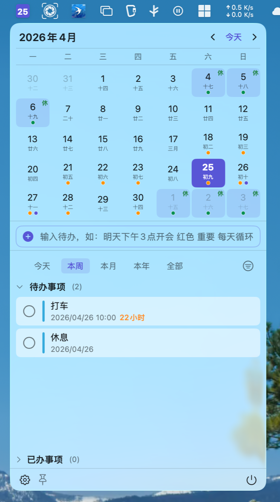
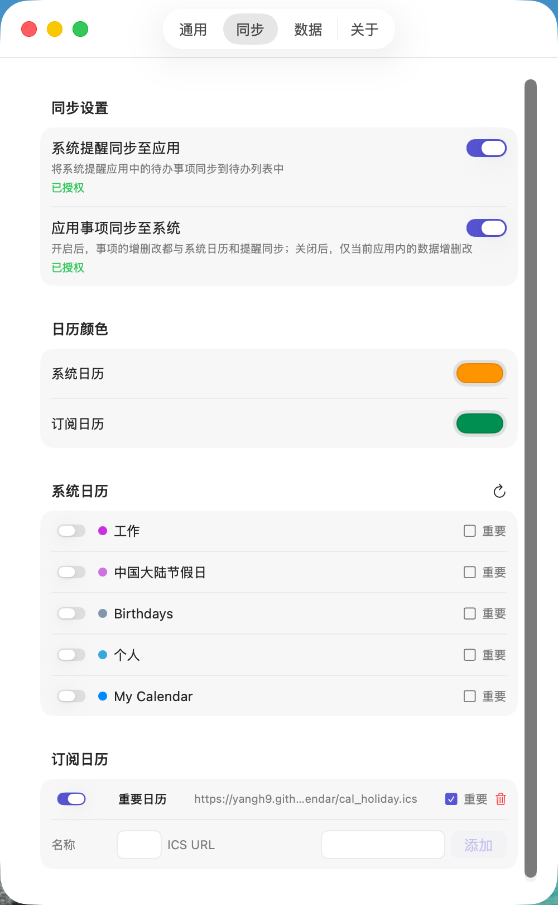
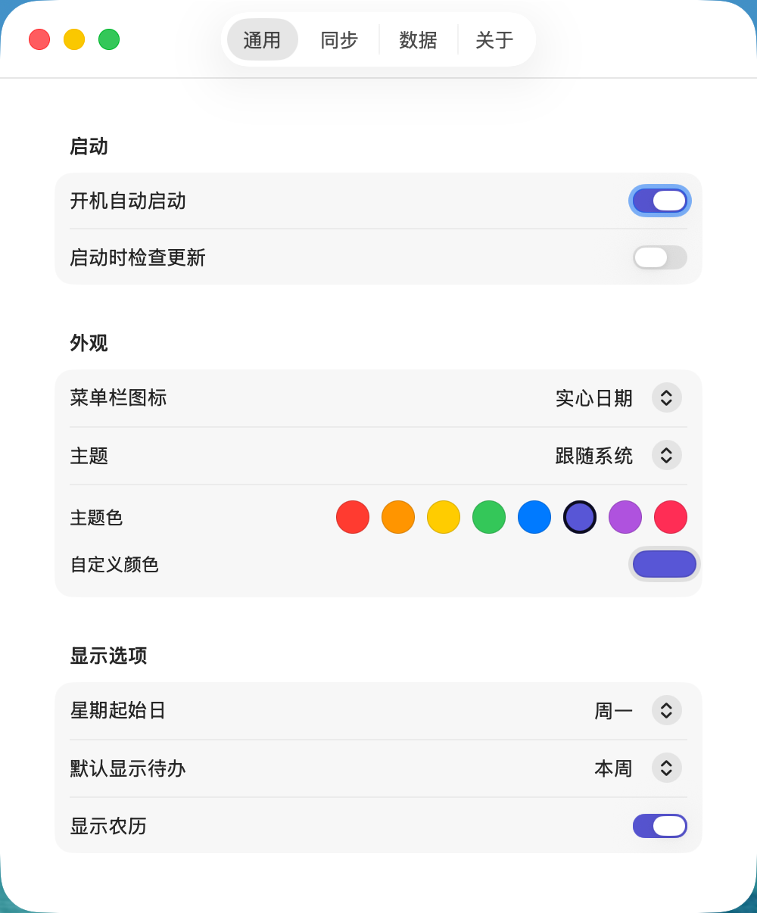
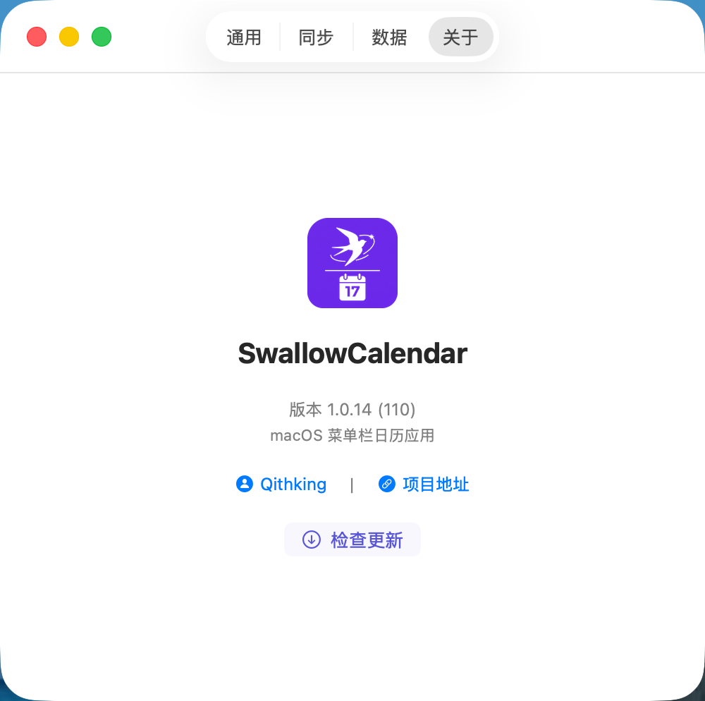
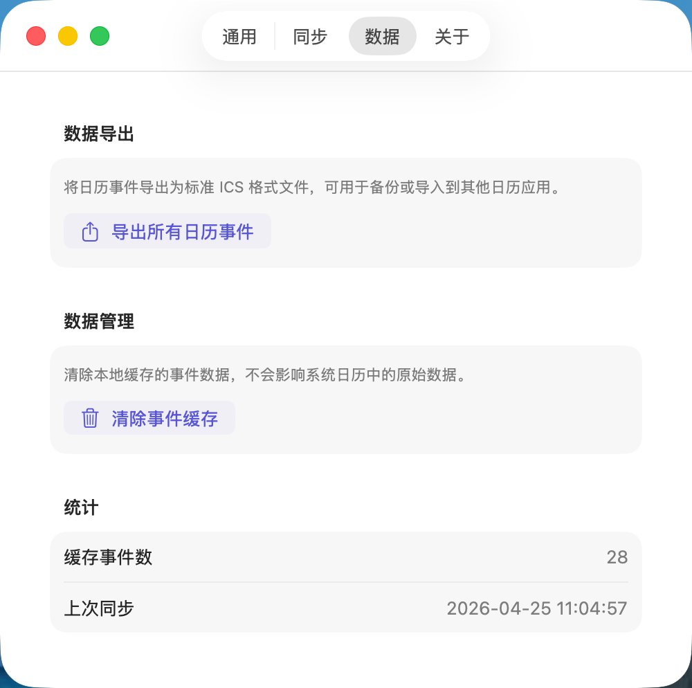

# SwallowCalendar

<p align="center">
  
  
  
  
  
</p>

<p align="center">
  <strong>🕊️ 燕子日历</strong> - 一款简洁优雅的 macOS 菜单栏日历应用
</p>

<p align="center">
  日历 · 农历 · 待办 · 桌面待办 · 节假日 · ICS订阅
</p>

---

## 📸 界面截图

<table>
  <tr>
    <td></td>
    <td></td>
  </tr>
  <tr>
    <td align="center"><strong>主界面 - 日历与待办</strong></td>
    <td align="center"><strong>日历详情 - 节假日标注</strong></td>
  </tr>
  <tr>
    <td></td>
    <td></td>
  </tr>
  <tr>
    <td align="center"><strong>待办事项管理</strong></td>
    <td align="center"><strong>设置与主题定制</strong></td>
  </tr>
  <tr>
    <td></td>
    <td></td>
  </tr>
  <tr>
    <td align="center"><strong>事件编辑</strong></td>
    <td></td>
  </tr>
</table>

---

## ✨ 功能特性

### 📅 日历功能
- **月历视图** - 直观的月份日历展示，支持日期快速定位
- **农历显示** - 完整支持农历日期展示
- **节假日标注** - 自动识别并标注法定节假日（休/班标记）
- **重要日期** - 支持自定义重要日期高亮显示

### 📝 待办事项
- **自然语言输入** - 智能识别时间、优先级、颜色和循环规则
  ```
  明天上午10点开会           → 创建明天的会议
  下午3点交报告 重要         → 创建带优先级的事件
  每周一晨会 每天循环        → 创建循环任务
  ```
- **智能过滤** - 主界面五档（今天/本周/本月/本年/全部）；菜单栏弹层与桌面面板为四档（今天/本周/本月/本年）
- **菜单栏悬停弹层** - 悬停菜单栏图标即弹出待办清单，可直接勾选完成，点击条目打开主界面
- **桌面常驻面板** - 独立待办面板，四档时段 + 状态筛选（全部/待办/已办），支持置顶与拖动
- **统一排序** - 有日期在前、无日期在后、已完成置底，与主界面口径一致
- **完成状态** - 标记完成/未完成，自动同步到系统提醒
- **循环任务** - 支持每日/每周/每月/每年循环
- **提醒功能** - 自定义提醒时间，可创建为系统提醒，到期弹出提醒通知
- **动态倒计时** - 待办事项实时显示剩余时间，单一 Timer + 最小堆高性能驱动
- **详情弹窗** - 悬停事项卡片查看完整详情（标题/时间/优先级/重复规则/日历来源），支持点击直接编辑
- **编辑面板** - 分组卡片式编辑界面，多行文本输入，快捷键保存/取消

### 🔗 数据同步
- **系统日历集成** - 与 macOS 系统日历无缝同步，支持双向 CRUD
- **系统提醒同步** - 与 macOS 提醒应用双向同步待办事项
- **ICS 订阅** - 支持订阅外部 ICS 日历（节假日日历等）
- **ICS 导出** - 一键导出全部事项为标准 ICS 文件，便于备份或迁移
- **本地缓存** - 事件数据本地缓存，快速响应，支持一键清除

### 🎨 主题定制
- **自定义主题色** - 随心所欲切换应用配色方案
- **菜单栏图标样式** - 多种图标风格可选（实心日期/描边日期/日历图标）
- **毛玻璃背景** - 系统级半透明效果
- **窗口缩放** - 支持自由调整窗口大小，自动保存窗口尺寸

### 🔒 数据安全
- **本地存储** - 事项数据仅保存在本机（应用支持目录与缓存目录，缓存文件权限 0600），不上传任何服务器
- **FileVault 建议** - 建议在"系统设置 → 隐私与安全性 → FileVault"中开启磁盘加密，防止设备失窃或备份盘泄露时本地日程数据被离线读取

---

## 📦 安装方式

### Homebrew（推荐）

```bash
brew install --cask swallowcalendar
```

### 手动安装

1. 从 [Releases](https://github.com/Qithking/SwallowCalendar/releases) 下载最新版本
2. 解压 `.dmg` 文件
3. 将应用拖入 `应用程序` 文件夹

---

## ⌨️ 快捷键

| 快捷键 | 功能 |
|--------|------|
| `⌘ + ,` | 打开设置 |
| `⌘ + Return` | 编辑面板中保存事项 |
| `Esc` | 编辑面板中取消编辑 |

---

## 🛠️ 开发指南

### 环境要求

| 工具 | 版本要求 |
|------|---------|
| macOS | 14.0 (Sonoma) 及以上 |
| Xcode | 15.0+ |
| Swift | 5.9+ |
| 架构 | Apple Silicon / Intel |

### 快速开始

```bash
# 克隆项目
git clone https://github.com/Qithking/SwallowCalendar.git

# 进入项目目录
cd SwallowCalendar

# 命令行构建（SPM）
swift build

# 运行 debug 版本
.build/debug/SwallowCalendar

# 运行单元测试
swift test

# 或使用 Xcode 打开，⌘+R 编译运行，⌘+U 运行单元测试
open SwallowCalendar.xcodeproj
```

### 发布流程

项目内置交互式发布工具 [release.sh](./release.sh)：

```bash
./release.sh
```

- **推送代码** - 提交并推送到远程 main 分支
- **发布新版本** - 创建版本 tag 推送到 GitHub，自动触发 [GitHub Actions](./.github/workflows/release.yml) 构建 Universal Binary 并生成 DMG 发布
- **版本维护** - 下载最新 DMG / 清理失败构建 / 删除 tag / 重新触发构建 / 推送 Beta 到 main

### 项目结构

```
SwallowCalendar/                        # 仓库根
├── SwallowCalendar/                    # 应用源码
│   ├── Models/                         # 数据模型（事件/缓存/循环/农历映射/偏好）
│   ├── Services/                       # 核心服务
│   │   ├── AppDelegate.swift           # 应用代理（状态栏/弹层/面板装配）
│   │   ├── AppLogger.swift             # 统一日志
│   │   ├── AppSettings.swift           # 设置管理
│   │   ├── CalendarService.swift       # 日历与提醒双向同步
│   │   ├── BackgroundSyncService.swift # 后台数据同步
│   │   ├── ICSService.swift            # ICS 订阅与导出
│   │   ├── NLPTaskParser.swift         # 自然语言解析
│   │   ├── BatchAddParser.swift        # 批量添加解析
│   │   ├── CountdownTimerManager.swift # 倒计时（单一 Timer + 最小堆）
│   │   ├── StatusBarIconManager.swift  # 菜单栏图标
│   │   ├── StatusItemHoverController.swift # 菜单栏悬停弹层控制
│   │   ├── DesktopTodoPanelManager.swift   # 桌面待办面板窗口
│   │   ├── TodayTodoSorter.swift       # 弹层排序
│   │   ├── HolidaySkipResolver.swift   # 节假日跳过判定
│   │   ├── ReminderAlertService.swift  # 到期提醒
│   │   ├── EditEventWindowManager.swift# 事件编辑窗口
│   │   ├── SettingsWindowManager.swift # 设置窗口
│   │   └── UpdateChecker.swift         # 更新检查
│   ├── Views/
│   │   ├── Calendar/                   # 月历网格/日期单元格/头部
│   │   ├── Events/                     # 待办列表/输入/编辑/过滤/完成归档
│   │   ├── Settings/                   # 通用/日历/数据/关于
│   │   └── StatusItem/                 # 菜单栏悬停弹层、桌面待办面板
│   ├── Utils/                          # 农历等工具
│   ├── SwallowCalendarApp.swift        # 应用入口
│   └── ContentView.swift               # 根视图
├── SwallowCalendarTests/               # 单元测试（服务/解析/缓存/循环/视图逻辑）
├── assets/                             # 截图等资源
└── release.sh                          # 交互式发布工具
```

### 主要依赖

- **SwiftUI** - 用户界面框架
- **SwiftData** - 数据持久化
- **EventKit** - 系统日历集成
- **NaturalLanguage** - 自然语言处理

## 🤝 贡献指南

欢迎提交 Issue 和 Pull Request！

### 贡献流程

1. **Fork** 本仓库
2. 创建特性分支 (`git checkout -b feature/AmazingFeature`)
3. 提交更改 (`git commit -m 'Add some AmazingFeature'`)
4. 推送到分支 (`git push origin feature/AmazingFeature`)
5. 创建 **Pull Request**

### 贡献规范

- 遵循 Swift 代码规范
- 添加必要的单元测试
- 更新相关文档

---

## 📄 许可证

本项目基于 [AGPLv3 License](./LICENSE) 开源。

---

## 📬 联系方式

- **GitHub**: [Qithking/SwallowCalendar](https://github.com/Qithking/SwallowCalendar)
- **作者**: [Qithking](https://github.com/thking)
- **问题反馈**: [Issues](https://github.com/Qithking/SwallowCalendar/issues)

---

<p align="center">
  <sub>⭐️ 如果觉得这个项目有帮助，欢迎 Star 支持一下！</sub>
</p>
